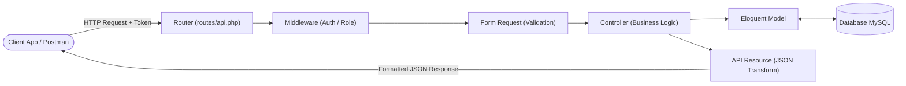
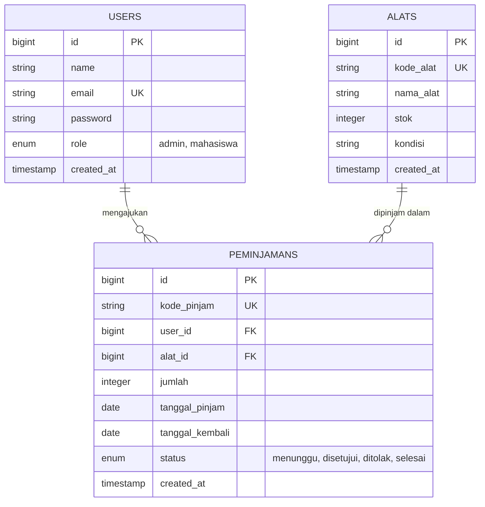
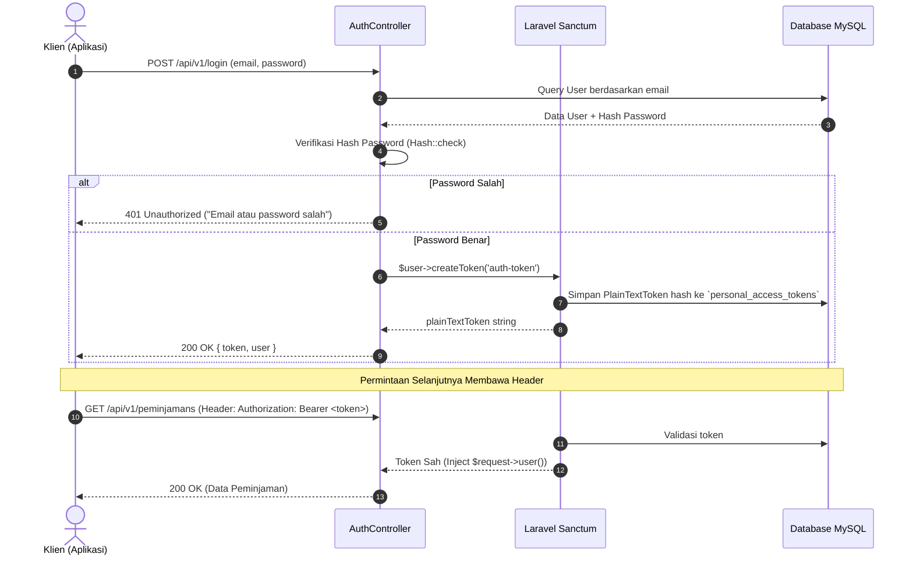

# 📚 Dokumentasi Pembelajaran RESTful API: Studi Kasus Nyata "LabPinjam API"

> **Studi Kasus:** Sistem RESTful API Peminjaman Alat Laboratorium Kampus (*LabPinjam API*)  
> **Teknologi:** Laravel (PHP 8.2+), MySQL, Laravel Sanctum, REST Architectural Style, OpenAPI 3.0  
> **Target Audiens:** Pengembang Web, Mahasiswa Teknik Informatika, dan Praktisi Backend yang ingin memahami standar industri API.

---

## 📑 Daftar Isi
1. [Demo Rekaman Aplikasi (http://127.0.0.1:8000/)](#-demo-rekaman-aplikasi-http1270018000)
2. [Latar Belakang & Analisis Studi Kasus](#1-latar-belakang--analisis-studi-kasus)
3. [Prinsip RESTful API & Arsitektur MVC](#2-prinsip-restful-api--arsitektur-mvc)
4. [Perancangan & Migrasi Database](#3-perancangan--migrasi-database)
5. [Eloquent ORM & Relasi Antar Model](#4-eloquent-orm--relasi-antar-model)
6. [Autentikasi Token dengan Laravel Sanctum](#5-autentikasi-token-dengan-laravel-sanctum)
7. [Struktur Kode & Pembuatan API Terstruktur](#6-struktur-kode--pembuatan-api-terstruktur)
8. [Daftar Endpoint & Pengujian API](#7-daftar-endpoint--pengujian-api)
9. [Panduan Step-by-Step Publikasi ke GitHub](#8-panduan-step-by-step-publikasi-ke-github)
10. [Tips Masuk ke GitHub Explore & Portofolio](#9-tips-masuk-ke-github-explore--portofolio)

---

## 📺 Demo Rekaman Aplikasi (http://127.0.0.1:8000/)

Tonton rekaman video pengujian langsung fitur antarmuka landing page, katalog alat laboratorium, autentikasi, dan pengujian API:  
👉 **[Tonton Video Demo Aplikasi: Studi Kasus RESTful API Laravel.webm](https://github.com/codysantoso/labpinjam-api/blob/main/Studi%20Kasus%20RESTful%20API%20Laravel.webm)**

---

## 1. Latar Belakang & Analisis Studi Kasus

### 1.1 Permasalahan Nyata
Di laboratorium universitas, proses peminjaman peralatan praktikum (seperti mikrokontroler Arduino/ESP32, osiloskop, sensor, multimeter) sering kali dicatat manual menggunakan buku log fisik atau spreadsheet terpisah. Hal ini menimbulkan:
- **Pencatatan stok tidak akurat** (stok fisik tidak sesuai data).
- **Kurangnya transparansi** mengenai siapa yang sedang meminjam dan kapan tenggat pengembalian.
- **Tidak adanya integrasi sistem** bagi aplikasi web frontend (React/Vue) atau aplikasi mobile (Flutter/Android).

### 1.2 Solusi: LabPinjam RESTful API
Membangun backend *decoupled* yang menyediakan antarmuka REST API aman, modular, dan terstandardisasi dengan fitur:
- **Manajemen Pengguna & Role:** Mahasiswa (*borrower*) dan Laboran/Admin (*manager*).
- **Manajemen Inventaris Alat:** CRUD alat laboratorium dengan pemantauan stok otomatis.
- **Siklus Peminjaman Terkontrol:** Mahasiswa mengajukan pinjaman -> stok berkurang -> pengembalian diverifikasi oleh laboran.

---

## 2. Prinsip RESTful API & Arsitektur MVC

### 2.1 Karakteristik Inti RESTful API
1. **Stateless:** Setiap *request* dari klien harus memuat semua informasi yang dibutuhkan server untuk memprosesnya (misal: header `Authorization: Bearer <token>`). Server tidak menyimpan sesi login dalam memory session PHP tradisional.
2. **Resource-Oriented (URI):** Endpoint menggunakan kata benda jamak (*nouns*), bukan kata kerja (*verbs*).
   - ✅ `GET /api/v1/alats` (Ambil daftar alat)
   - ❌ `GET /api/v1/getSemuaAlat` (Hindari gaya RPC)
3. **HTTP Methods Standar:**
   - `GET` : Membaca data (aman & idempoten).
   - `POST` : Membuat data baru.
   - `PUT / PATCH` : Memperbarui data seluruhnya / sebagian.
   - `DELETE` : Menghapus data.
4. **Standard HTTP Status Codes:**
   - `200 OK` : Permintaan berhasil diproses.
   - `201 Created` : Entitas baru berhasil dibuat.
   - `204 No Content` : Sukses tanpa *payload* balasan (misal setelah DELETE).
   - `400 Bad Request` : Format sintaks permintaan salah.
   - `401 Unauthorized` : Token tidak ada atau kedaluwarsa.
   - `403 Forbidden` : Terautentikasi, namun tidak punya hak akses (Role Guard).
   - `404 Not Found` : Data tidak ditemukan.
   - `422 Unprocessable Content` : Gagal validasi data input.
   - `500 Internal Server Error` : Terjadi kesalahan fatal di sisi server.

### 2.2 Alur Arsitektur MVC untuk REST API
Dalam konteks API modern, elemen **View** digantikan oleh **API Resource / JSON Formatter**:



---

## 3. Perancangan & Migrasi Database

### 3.1 Entity Relationship Diagram (ERD)



### 3.2 File Migrasi

#### A. Tabel `users`
File: `database/migrations/0001_01_01_000000_create_users_table.php`
```php
Schema::create('users', function (Blueprint $table) {
    $table->id();
    $table->string('name');
    $table->string('email')->unique();
    $table->timestamp('email_verified_at')->nullable();
    $table->string('password');
    $table->enum('role', ['admin', 'mahasiswa'])->default('mahasiswa');
    $table->rememberToken();
    $table->timestamps();
});
```

#### B. Tabel `alats`
File: `database/migrations/xxxx_xx_xx_create_alats_table.php`
```php
Schema::create('alats', function (Blueprint $table) {
    $table->id();
    $table->string('kode_alat', 50)->unique();
    $table->string('nama_alat', 150);
    $table->unsignedInteger('stok')->default(0);
    $table->string('kondisi')->default('Baik');
    $table->timestamps();
});
```

#### C. Tabel `peminjamans`
File: `database/migrations/xxxx_xx_xx_create_peminjamans_table.php`
```php
Schema::create('peminjamans', function (Blueprint $table) {
    $table->id();
    $table->string('kode_pinjam', 50)->unique();
    $table->foreignId('user_id')->constrained('users')->cascadeOnDelete();
    $table->foreignId('alat_id')->constrained('alats')->restrictOnDelete();
    $table->unsignedInteger('jumlah');
    $table->date('tanggal_pinjam');
    $table->date('tanggal_kembali');
    $table->enum('status', ['menunggu', 'disetujui', 'ditolak', 'selesai'])->default('menunggu');
    $table->timestamps();
});
```

---

## 4. Eloquent ORM & Relasi Antar Model

Eloquent memetakan tabel database ke dalam objek PHP dengan cara yang ekspresif.

### 4.1 Model `User` (`app/Models/User.php`)
```php
namespace App\Models;

use Illuminate\Database\Eloquent\Factories\HasFactory;
use Illuminate\Foundation\Auth\User as Authenticatable;
use Laravel\Sanctum\HasApiTokens;

class User extends Authenticatable
{
    use HasApiTokens, HasFactory;

    protected $fillable = [
        'name',
        'email',
        'password',
        'role',
    ];

    protected $hidden = [
        'password',
        'remember_token',
    ];

    protected function casts(): array
    {
        return [
            'email_verified_at' => 'datetime',
            'password' => 'hashed',
        ];
    }

    public function peminjamans()
    {
        return $this->hasMany(Peminjaman::class);
    }
}
```

### 4.2 Model `Alat` (`app/Models/Alat.php`)
```php
namespace App\Models;

use Illuminate\Database\Eloquent\Factories\HasFactory;
use Illuminate\Database\Eloquent\Model;

class Alat extends Model
{
    use HasFactory;

    protected $table = 'alats';

    protected $fillable = [
        'kode_alat',
        'nama_alat',
        'stok',
        'kondisi',
    ];

    public function peminjamans()
    {
        return $this->hasMany(Peminjaman::class);
    }
}
```

### 4.3 Model `Peminjaman` (`app/Models/Peminjaman.php`)
```php
namespace App\Models;

use Illuminate\Database\Eloquent\Factories\HasFactory;
use Illuminate\Database\Eloquent\Model;

class Peminjaman extends Model
{
    use HasFactory;

    protected $fillable = [
        'kode_pinjam',
        'user_id',
        'alat_id',
        'jumlah',
        'tanggal_pinjam',
        'tanggal_kembali',
        'status',
    ];

    public function user()
    {
        return $this->belongsTo(User::class);
    }

    public function alat()
    {
        return $this->belongsTo(Alat::class);
    }
}
```

---

## 5. Autentikasi Token dengan Laravel Sanctum

Sanctum menyediakan sistem otentikasi token yang ringan untuk SPA, aplikasi seluler, dan API berbasis token sederhana.

### 5.1 Alur Kerja Autentikasi Sanctum



### 5.2 Implementasi `AuthController.php`
```php
namespace App\Http\Controllers\Api\V1;

use App\Http\Controllers\Controller;
use App\Models\User;
use Illuminate\Http\Request;
use Illuminate\Support\Facades\Hash;
use Illuminate\Validation\ValidationException;

class AuthController extends Controller
{
    public function register(Request $request)
    {
        $validated = $request->validate([
            'name' => 'required|string|max:255',
            'email' => 'required|string|email|max:255|unique:users',
            'password' => 'required|string|min:8',
        ]);

        $user = User::create([
            'name' => $validated['name'],
            'email' => $validated['email'],
            'password' => Hash::make($validated['password']),
            'role' => 'mahasiswa', // default role
        ]);

        $token = $user->createToken('auth_token')->plainTextToken;

        return response()->json([
            'success' => true,
            'message' => 'Registrasi berhasil',
            'token' => $token,
            'data' => $user
        ], 201);
    }

    public function login(Request $request)
    {
        $request->validate([
            'email' => 'required|email',
            'password' => 'required',
        ]);

        $user = User::where('email', $request->email)->first();

        if (! $user || ! Hash::check($request->password, $user->password)) {
            return response()->json([
                'success' => false,
                'message' => 'Email atau password salah.'
            ], 401);
        }

        $token = $user->createToken('auth_token')->plainTextToken;

        return response()->json([
            'success' => true,
            'message' => 'Login berhasil',
            'token' => $token,
            'user' => [
                'id' => $user->id,
                'name' => $user->name,
                'email' => $user->email,
                'role' => $user->role,
            ]
        ], 200);
    }

    public function logout(Request $request)
    {
        // Menghapus token yang sedang digunakan untuk request saat ini
        $request->user()->currentAccessToken()->delete();

        return response()->json([
            'success' => true,
            'message' => 'Logout berhasil'
        ], 200);
    }

    public function me(Request $request)
    {
        return response()->json([
            'success' => true,
            'data' => $request->user()
        ], 200);
    }
}
```

---

## 6. Struktur Kode & Pembuatan API Terstruktur

### 6.1 Format Standarisasi Respons JSON
Semua endpoint menggunakan struktur respons konsisten:
```json
{
  "success": true,
  "message": "Deskripsi singkat hasil proses",
  "data": { ... },
  "errors": null
}
```

### 6.2 Validasi Data Menggunakan Form Request
Hindari validasi langsung di dalam Controller (*Fat Controller*). Buat Form Request terpisah:
```bash
php artisan make:request Api/V1/Alat/StoreAlatRequest
```
Contoh file `StoreAlatRequest.php`:
```php
namespace App\Http\Requests\Api\V1\Alat;

use Illuminate\Foundation\Http\FormRequest;

class StoreAlatRequest extends FormRequest
{
    public function authorize(): bool
    {
        return $this->user() && $this->user()->role === 'admin';
    }

    public function rules(): array
    {
        return [
            'kode_alat' => 'required|string|max:50|unique:alats,kode_alat',
            'nama_alat' => 'required|string|max:150',
            'stok'      => 'required|integer|min:0',
            'kondisi'   => 'nullable|string|max:100',
        ];
    }
}
```

### 6.3 Transformasi Data dengan Eloquent API Resource
Untuk menyembunyikan kolom sensitif (seperti password hash, timestamp internal, ID relasi yang tidak perlu) dan menjaga kestabilan kontrak API:
```bash
php artisan make:resource Api/V1/AlatResource
```
Contoh `AlatResource.php`:
```php
namespace App\Http\Resources\Api\V1;

use Illuminate\Http\Request;
use Illuminate\Http\Resources\Json\JsonResource;

class AlatResource extends JsonResource
{
    public function toArray(Request $request): array
    {
        return [
            'id' => $this->id,
            'kode' => $this->kode_alat,
            'nama' => $this->nama_alat,
            'stok_tersedia' => (int) $this->stok,
            'kondisi' => $this->kondisi,
            'didaftarkan_pada' => $this->created_at->format('Y-m-d H:i:s'),
        ];
    }
}
```

### 6.4 Implementasi Bisnis: Transaksi Database pada Peminjaman
Saat meminjam alat, pengurangan stok dan pencatatan transaksi harus berada dalam satu transaksi atomik (**ACID transaction**):

```php
namespace App\Http\Controllers\Api\V1;

use App\Http\Controllers\Controller;
use App\Models\Alat;
use App\Models\Peminjaman;
use Illuminate\Http\Request;
use Illuminate\Support\Facades\DB;
use Illuminate\Support\Str;

class PeminjamanController extends Controller
{
    public function store(Request $request)
    {
        $validated = $request->validate([
            'alat_id' => 'required|exists:alats,id',
            'jumlah' => 'required|integer|min:1',
            'tanggal_pinjam' => 'required|date|after_or_equal:today',
            'tanggal_kembali' => 'required|date|after:tanggal_pinjam',
        ]);

        return DB::transaction(function () use ($validated, $request) {
            $alat = Alat::lockForUpdate()->find($validated['alat_id']);

            if ($alat->stok < $validated['jumlah']) {
                return response()->json([
                    'success' => false,
                    'message' => 'Stok alat tidak mencukupi untuk dipinjam.'
                ], 422);
            }

            // Kurangi stok alat
            $alat->decrement('stok', $validated['jumlah']);

            // Buat record peminjaman
            $peminjaman = Peminjaman::create([
                'kode_pinjam' => 'PINJ-' . strtoupper(Str::random(8)),
                'user_id' => $request->user()->id,
                'alat_id' => $validated['alat_id'],
                'jumlah' => $validated['jumlah'],
                'tanggal_pinjam' => $validated['tanggal_pinjam'],
                'tanggal_kembali' => $validated['tanggal_kembali'],
                'status' => 'menunggu',
            ]);

            return response()->json([
                'success' => true,
                'message' => 'Pengajuan peminjaman berhasil dibuat.',
                'data' => $peminjaman
            ], 201);
        });
    }
}
```

### 6.5 Pengaturan Routing (`routes/api.php`)
```php
use App\Http\Controllers\Api\V1\AuthController;
use App\Http\Controllers\Api\V1\AlatController;
use App\Http\Controllers\Api\V1\PeminjamanController;
use Illuminate\Support\Facades\Route;

Route::prefix('v1')->group(function () {
    // Public Routes
    Route::post('/register', [AuthController::class, 'register']);
    Route::post('/login', [AuthController::class, 'login']);
    Route::get('/alats', [AlatController::class, 'index']);
    Route::get('/alats/{id}', [AlatController::class, 'show']);

    // Protected Routes (Perlu Bearer Token)
    Route::middleware('auth:sanctum')->group(function () {
        Route::post('/logout', [AuthController::class, 'logout']);
        Route::get('/user', [AuthController::class, 'me']);

        // Transaksi Peminjaman
        Route::get('/peminjamans', [PeminjamanController::class, 'index']);
        Route::post('/peminjamans', [PeminjamanController::class, 'store']);
        Route::get('/peminjamans/{id}', [PeminjamanController::class, 'show']);

        // Khusus Admin (Bisa di-protect dengan Middleware Role)
        Route::middleware('role:admin')->group(function () {
            Route::post('/alats', [AlatController::class, 'store']);
            Route::put('/alats/{id}', [AlatController::class, 'update']);
            Route::delete('/alats/{id}', [AlatController::class, 'destroy']);
            Route::patch('/peminjamans/{id}/status', [PeminjamanController::class, 'updateStatus']);
        });
    });
});
```

---

## 7. Daftar Endpoint & Pengujian API

Berdasarkan spesifikasi `openapi.yaml`, berikut daftar rute API:

| HTTP Method | Endpoint URL | Autentikasi | Hak Akses | Deskripsi |
| :--- | :--- | :--- | :--- | :--- |
| `POST` | `/api/v1/login` | Tidak | Publik | Login & memperoleh Bearer Token |
| `POST` | `/api/v1/logout` | **Ya** | All User | Revoke Token / Keluar sesi |
| `GET` | `/api/v1/alats` | Tidak | Publik | Melihat katalog seluruh alat |
| `POST` | `/api/v1/alats` | **Ya** | Admin | Menambah inventaris alat baru |
| `GET` | `/api/v1/alats/{id}` | Tidak | Publik | Melihat rincian satu alat |
| `PUT` | `/api/v1/alats/{id}` | **Ya** | Admin | Memperbarui data alat |
| `DELETE` | `/api/v1/alats/{id}` | **Ya** | Admin | Menghapus alat |
| `GET` | `/api/v1/peminjamans` | **Ya** | All User | Mahasiswa (milik sendiri) / Admin (semua) |
| `POST` | `/api/v1/peminjamans` | **Ya** | Mahasiswa | Mengajukan permohonan pinjam alat |

---

## 8. Panduan Step-by-Step Publikasi ke GitHub

Berikut adalah tutorial lengkap mempublikasikan repositori ini ke [GitHub](https://github.com/) agar rapi, profesional, dan siap dipelajari komunitas.

### Langkah 1: Pastikan `.gitignore` Sudah Benar
File `.env` (berisi password database dan app key) serta folder `vendor/` dan `node_modules/` **TIDAK BOLEH** terunggah ke GitHub.  
Pastikan isi `.gitignore` pada root proyek minimal memiliki baris berikut:
```gitignore
/vendor
/.env
/.env.backup
/.env.production
/public/storage
/storage/*.key
/node_modules
```

### Langkah 2: Inisialisasi Git Lokal
Buka terminal PowerShell pada direktori proyek (`D:\laragondev\www\labpinjam-api`), lalu jalankan:

```powershell
# 1. Inisialisasi git repository
git init -b main

# 2. Cek status file yang akan di-track
git status

# 3. Tambahkan seluruh berkas ke staging area
git add .

# 4. Buat initial commit dengan pesan deskriptif
git commit -m "feat: inisialisasi labpinjam-api studi kasus pembelajaran RESTful API Laravel"
```

### Langkah 3: Buat Repositori Baru di GitHub
1. Buka peramban dan masuk ke akun GitHub Anda: [https://github.com/](https://github.com/).
2. Buat repository baru melalui link: [https://github.com/new](https://github.com/new).
3. Isi kolom yang diminta:
   - **Repository name:** `labpinjam-api` atau `laravel-rest-api-study-case`
   - **Description:** `RESTful API Sistem Peminjaman Alat Laboratorium - Studi Kasus Pembelajaran Laravel, MVC, Eloquent ORM, dan Sanctum Auth.`
   - **Visibility:** Pilih **Public** (agar dapat diakses di GitHub Explore).
   - **Initialize this repository with:** *Kosongkan semua* (jangan centang Add README, .gitignore, atau license karena sudah dibuat di lokal).
4. Klik tombol hijau **Create repository**.

### Langkah 4: Hubungkan Git Lokal ke Remote GitHub & Push
Salin URL repository dari GitHub (format HTTPS atau SSH), lalu jalankan di terminal Anda:

```powershell
# Tambahkan URL remote (ganti 'username-kamu' dengan username GitHub Anda)
git remote add origin https://github.com/username-kamu/labpinjam-api.git

# Pastikan branch saat ini adalah main
git branch -M main

# Unggah seluruh commit ke GitHub
git push -u origin main
```

Jika diminta autentikasi:
- Masukkan **Username GitHub**.
- Masukkan **Personal Access Token (PAT)** GitHub sebagai pengganti password (dapat dibuat di menu *GitHub Settings -> Developer Settings -> Personal Access Tokens*).

---

## 9. Tips Masuk ke GitHub Explore & Portofolio

Halaman [GitHub Explore](https://github.com/explore) mengkurasi repositori berdasarkan topik, popularitas, keterbacaan, dan struktur proyek. Agar repositori Anda mudah ditemukan orang lain:

1. **Tambahkan Topics (Tags) pada Repositori:**
   Di halaman utama repo GitHub Anda, klik ikon gerigi ⚙️ di samping kanan bagian **About**, lalu tambahkan kata kunci berikut:
   - `laravel`
   - `rest-api`
   - `restful-api`
   - `eloquent-orm`
   - `sanctum`
   - `clean-architecture`
   - `php`
   - `api-documentation`
   - `studi-kasus`

2. **Sertakan Dokumentasi Interaktif (OpenAPI/Swagger):**
   - Proyek ini sudah dilengkapi file `openapi.yaml`. 
   - Anda dapat menambahkan badge atau instruksi bagi pengunjung untuk membuka file tersebut di [Swagger Editor](https://editor.swagger.io/).

3. **Gunakan Semantic Commit Messages:**
   - `feat:` untuk penambahan fitur baru (misal: `feat: implementasi sanctum authentication`).
   - `fix:` untuk perbaikan bug.
   - `docs:` untuk pembaruan dokumentasi.
   - `refactor:` untuk pembersihan struktur kode tanpa mengubah fungsi.

4. **Tambahkan Lisensi Open-Source:**
   Gunakan lisensi seperti **MIT License** agar programmer lain bebas belajar dan berkontribusi secara legal.

---

*Dokumentasi ini disusun sebagai panduan komprehensif implementasi dan publikasi RESTful API modern.*

